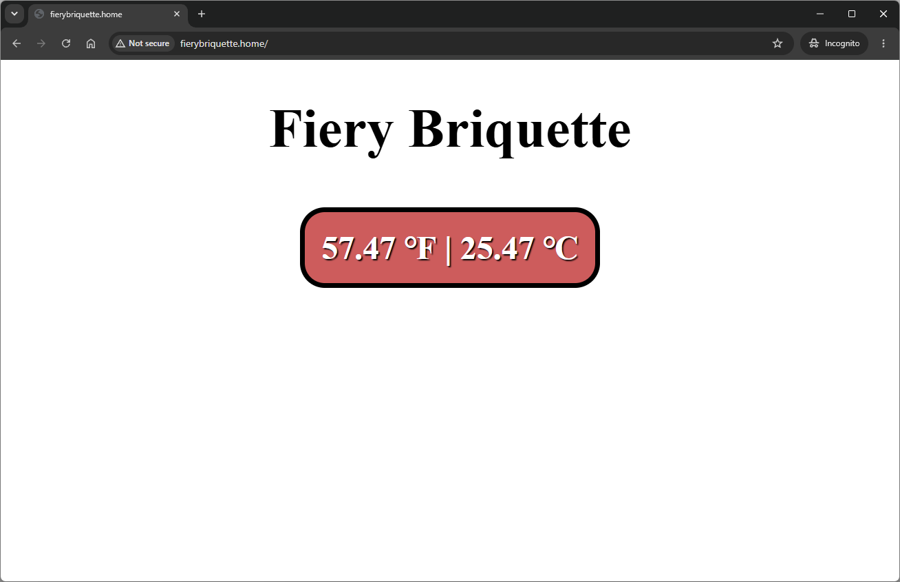

# fiery_briquette

A Bluetooth grill thermometer website locally hosted on an Arduino.

- Developed in Arduino's custom C++.
- Hosts a local web server on the Arduino, displaying and updating the temperature of the thermometer.
- For posterity, contains a deprecated React Native (TypeScript) mobile app from when the thermometer used to use Bluetooth.

